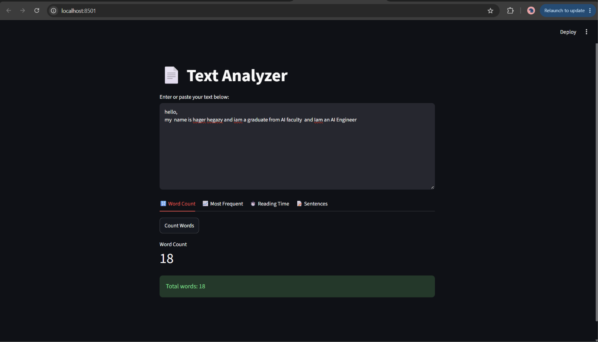
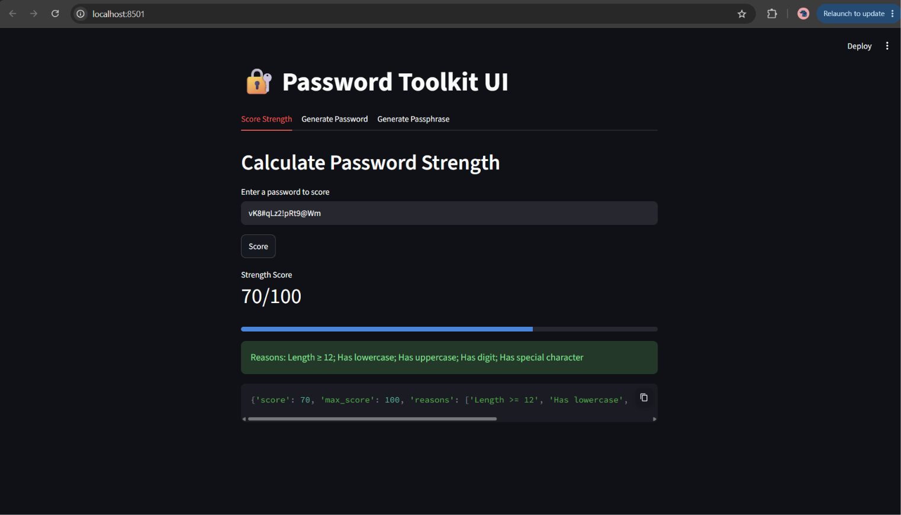
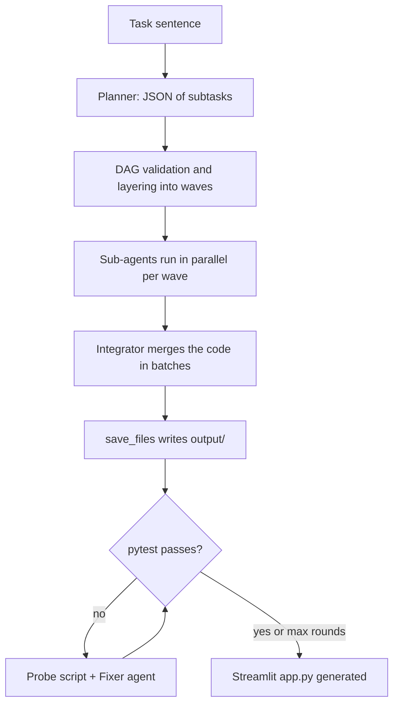

# Multi-Agent Code Generator

A small orchestrator that turns a one-sentence task into a working Python project: it **plans** the work, lets several **LLM sub-agents** write the parts in parallel, **merges** them, **runs the tests**, **fixes failures automatically**, and finally generates a **Streamlit UI** on top.




**Demo:** [DEMO](https://lnkd.in/p/e9fjYi8Y)

## How it works



1. **Planner** (`plan`): the LLM splits the task into the smallest useful subtasks and returns JSON with `id`, `description`, `role` and `depends_on`.
2. **DAG validation** (`validate_and_layer`): checks for duplicate ids, unknown dependencies and cycles, then groups subtasks into waves (Kahn's algorithm). Everything inside a wave can run in parallel.
3. **Sub-agents** (`SubAgent`, `execute`): each subtask gets its own system prompt and receives the outputs of the subtasks it depends on. Waves run with a thread pool.
4. **Integrator** (`integrate`, `merge_step`): merges all pieces into one package, removes duplicates, and keeps names and imports consistent. It works in batches to stay within the context limit.
5. **File writer** (`save_files`): parses `**path**` + fenced code blocks from the LLM reply and writes the files to `output/`.
6. **Test-and-fix loop** (`fix_loop`): runs `pytest`; on failure, a **probe** script prints the real behavior of the suspicious functions, then a **fixer** agent receives the pytest output, the probe output, and all files, and returns the changed files. Up to 4 rounds.
7. **UI builder** (`build_ui`): generates `output/app.py`, a Streamlit interface for the finished package.

The agents are not separate programs. They are the same `call_llm` function with different prompts and context.

## Requirements

- Python 3.10+
- An API key for any **OpenAI-compatible** endpoint (NVIDIA, Groq, OpenRouter, and others)

## Installation

```bash
git clone https://github.com/<your-username>/<your-repo>.git
cd <your-repo>

python -m venv .venv
# Windows (PowerShell): .venv\Scripts\Activate.ps1
# macOS / Linux:        source .venv/bin/activate

pip install -r requirements.txt
pip install streamlit        # needed to run the generated UI
```

## Configuration

Copy `.env.example` to `.env` and fill in your values:

| Variable   | Description                                              |
| ---------- | -------------------------------------------------------- |
| `base_url` | OpenAI-compatible API endpoint                           |
| `api_key`  | Your API key                                             |
| `MODEL`    | Exact model name from your provider                      |

Use one `NAME=value` per line, with no quotes and no spaces around `=`. Never commit `.env`.

## Usage

1. Open `Notebook.py` and set your task at the bottom of the file:

   ```python
   TASK = ("Build a Python password toolkit that scores password strength with clear reasons, "
           "generates secure passwords with configurable length and character sets, "
           "and generates passphrases from a built-in word list, with a CLI and unit tests. "
           "Use only the standard library. Functions must return plain dicts so a UI can display them.")
   ```

2. Delete the old `output/` folder if you are starting a new task, then run:

   ```bash
   python Notebook.py
   ```

3. Run the generated app:

   ```bash
   cd output
   streamlit run app.py
   ```

### Flags in `ds.py`

| Flag                | Effect                                                                 |
| ------------------- | ---------------------------------------------------------------------- |
| `FIX_ONLY = True`   | Skip planning and integration, only run the fix loop on `output/`      |
| `USE_CACHE = True`  | Reuse the sub-agent results saved in `results.pkl`                     |

### Tips for good tasks

- Say "use only the standard library" to avoid missing-package errors.
- Ask for functions that return plain dicts and lists, so the UI is easy to build.
- Avoid tasks that need network calls or randomness without a seed, because those make tests flaky.

## Project structure

```
.
├── Notebook.py              # the whole orchestrator
├── requirements.txt
├── .env.example
├── assets/            # screenshots
└── output/            # generated project (created by the pipeline)
```

## Troubleshooting

- **`could not parse statement` from python-dotenv:** a line in `.env` is not in `NAME=value` form.
- **401 error mentioning another provider:** `base_url` was not loaded, so the client fell back to the default OpenAI URL.
- **`APITimeoutError` or a hang:** the model is slow or overloaded. Try another model. The client timeout is set in `ds.py`, and `call_llm` retries on timeouts.
- **404 or 410 for a model:** the model was retired. List the models available to your key and pick another one.
- **Empty replies with `finish_reason=length`:** reasoning models can spend all tokens thinking. Use a non-reasoning model or raise `max_tokens`.

## License

